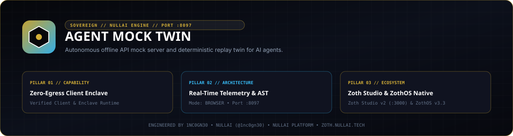

<div align="center">
  
</div>

<br />

# AGENT MOCK TWIN ⚡

> **Autonomous Offline API Mock & Network Twin for AI Agents**  
> *Run autonomous agents in CI/CD and local development loops with **$0 API token cost**, zero latency, and 100% deterministic outputs.*

[](https://github.com/1nc0gn30/agent-mock-twin)
[](https://python.org)
[](https://github.com/1nc0gn30/agent-mock-twin)
[](LICENSE)
[](https://github.com/1nc0gn30/agent-mock-twin)

---

## 💎 What It Does

Autonomous AI agents iterate over complex loops: planning, tool execution, memory retrieval, and self-auditing. In modern development:
1. **Rampant Token Costs**: Every automated CI test run hits live LLM provider APIs (OpenAI, Anthropic, Gemini), burning hundreds of dollars in token billing.
2. **Brittle Flakiness**: Rate limits (HTTP 429), upstream outages, and stochastic model responses cause integration test suites to randomly fail.
3. **Slow Latency**: Waiting 1,500ms–6,000ms per agent turn stalls CI pipelines and local developer velocity.

**AGENT MOCK TWIN** solves this by establishing an autonomous, zero-dependency offline network twin. It ingests real network recordings (standard HAR 1.2 files from `agent-egress-sentinel` or OpenAPI 3.0 specs) and hosts a microsecond-latency local mock server that deterministically answers agent queries at **$0.00 cost**.

---

## 🏛️ How It Works: The Multi-Tier Matching Engine

```text
    ┌─────────────────────────────────────────────────────────┐
    │              ● AGENT MOCK TWIN (PORT 8097)              │
    │                                                         │
    │   ┌───────────────────────┐   ┌─────────────────────┐   │
    │   │  MULTI-TIER MATCHER   │   │   SQLITE STORAGE    │   │
    │   │  1. Exact Hash Match  │   │  • Routes Cache     │   │
    │   │  2. Fuzzy Semantic    │   │  • Hit Telemetry    │   │
    │   │  3. Fallback Synth    │   │  • Microsec Lookups │   │
    │   └───────────────────────┘   └─────────────────────┘   │
    │               ▲                          ▲              │
    │               │                          │              │
    └───────────────┼──────────────────────────┼──────────────┘
                    │                          │
           Intercepted Traffic        Ingested HAR / Specs
                    │                          │
        ┌───────────────────────┐   ┌─────────────────────┐
        │   AUTONOMOUS AGENT    │   │ HAR 1.2 / OpenAPI   │
        │   pytest / CI Runner  │   │ Egress Recordings   │
        └───────────────────────┘   └─────────────────────┘
```

### Multi-Tier Request Matcher
1. **Tier 1 — Exact Match**: Matches HTTP Method + Normalized Path + Request Body SHA256 Hash. Answers with the exact recorded status and response payload with 100% fidelity.
2. **Tier 2 — Fuzzy Semantic Match**: Reconciles subtle prompt drift and variable JSON parameter keys using Jaccard key similarity and model matching.
3. **Tier 3 — Fallback Synthesis**: If an agent hits an unseen endpoint (e.g. `/v1/chat/completions` or `/v1/messages`), the server synthesizes a valid, structured provider response with zero outbound internet access.

---

## 🚀 Quickstart & Zero-Pip Installation

`agent-mock-twin` requires **zero pip packages**. It runs directly on Python 3.10+ standard library.

```bash
# Clone the repository
git clone https://github.com/1nc0gn30/agent-mock-twin.git
cd agent-mock-twin

# Start server directly
python3 server.py --port 8097
```

- **Web Dashboard**: `http://localhost:8097/`
- **OpenAI Mock Base**: `http://localhost:8097/v1`
- **Anthropic Mock Base**: `http://localhost:8097`

---

## 🛠️ ZothOS CLI & Subcommands

The tool is pre-installed across ZothOS as `agent-mock-twin` and `agent-mock`:

```bash
# Check status and telemetry
agent-mock-twin --status
agent-mock-twin --json

# Ingest network archive or OpenAPI specification
agent-mock import traffic.har
agent-mock import openapi_spec.json

# Display token savings and telemetry stats
agent-mock stats

# Run agent suites with zero token burn
agent-mock run -- pytest tests/test_agent_workflow.py
agent-mock run -- python my_autonomous_agent.py
```

---

## 🌐 Telemetry & REST API

| Endpoint | Method | Description |
| :--- | :--- | :--- |
| `/health` | `GET` | Health check endpoint returning status, version, and route counts. |
| `/api/stats` | `GET` | Aggregated counters: total hits, tokens saved, USD saved, active routes. |
| `/api/routes` | `GET` | List all indexed mock routes with method, path, provider, and hit counts. |
| `/api/hits` | `GET` | Retrieve the last N intercepted requests for the replay log. |
| `/api/stream` | `GET` | Server-Sent Events (SSE) live feed broadcasting request hits in real time. |
| `/api/upload` | `POST` | Upload new HAR or OpenAPI blueprints directly via REST. |
| `/api/config` | `POST` | Adjust base latency simulation, jitter, and chaos injection rates. |
| `/api/test` | `POST` | Test playground endpoint to simulate mock requests and view responses. |

---

## ☕ 100% Free & Open-Access Support Architecture

Agent Mock Twin is **100% free, unlocked, and open-access by default**. There are zero paywalls, zero blurred locks, zero license modals, and zero subscription gates.

If you find this utility valuable, support sovereign open-source engineering:
- **☕ Buy Us a Coffee via Stripe**: [https://buy.stripe.com/3cIfZg27PdKo2D64Ocfw40X](https://buy.stripe.com/3cIfZg27PdKo2D64Ocfw40X)
- **◎ Solana Tip Address**: `GG2eQbVh8ut1BK6j1A2tz7pSySdLpD38BgyEhGcxdXoK`

---

## 🔒 Network Exposure & Security

The server binds to `127.0.0.1` by default. To reach it from other devices, opt in explicitly with `--host 0.0.0.0` (or set `ZOTH_BIND_HOST=0.0.0.0`) and only on a trusted network.

Browser requests are only accepted from `localhost` / `127.0.0.1` pages: cross-site POSTs get `403` and CORS never answers `*`, so arbitrary third-party websites cannot drive the local server.

---

## 📜 Attribution & License

- **Engineered by**: 1nc0gn30 • NullAI ([@1nc0gn30](https://github.com/1nc0gn30)) • [NullAI Platform](https://nullai.tech)
- **License**: MIT License
